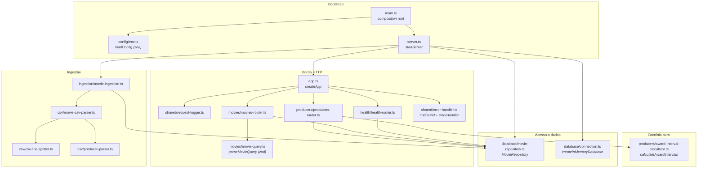
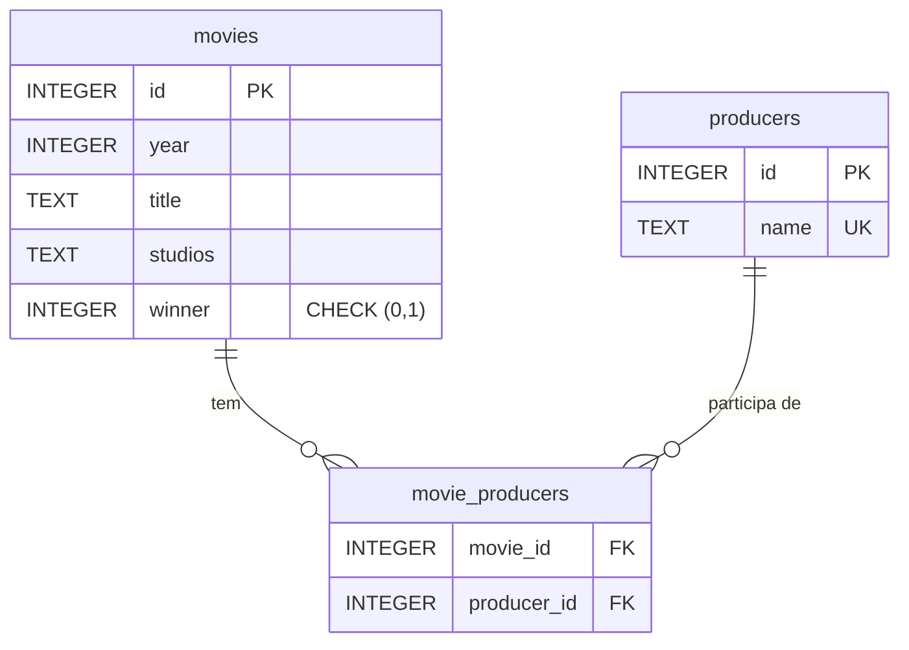
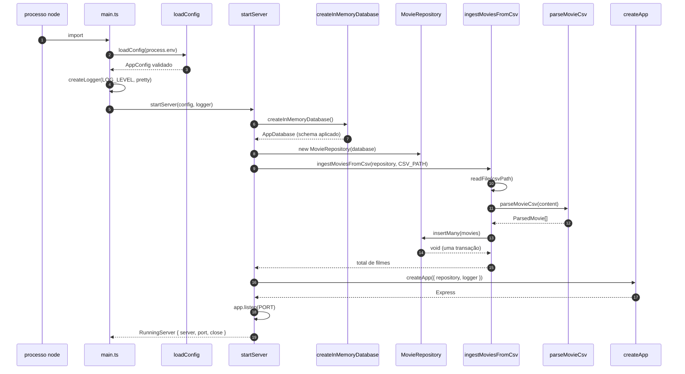
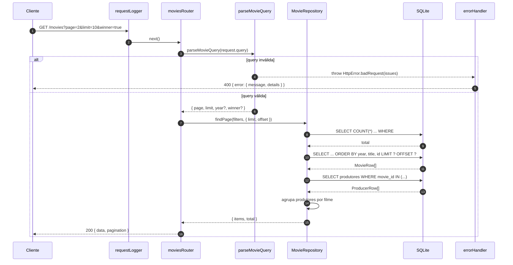
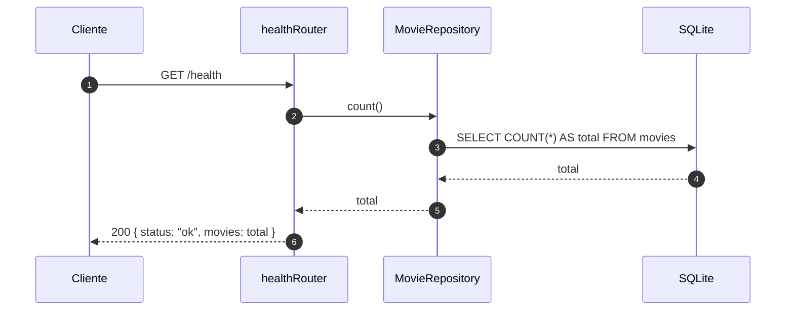
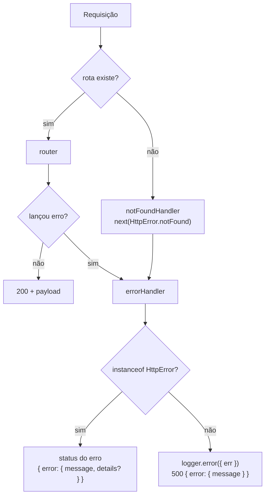
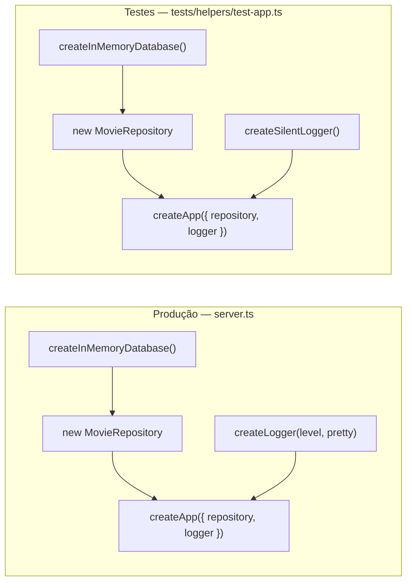

# Arquitetura

Este documento descreve a arquitetura da API, a direção das dependências e o fluxo de comunicação
entre os módulos em cada endpoint. O registro das decisões tomadas durante o desenvolvimento está em
[`ai-interactions.md`](./ai-interactions.md); as regras permanentes para agentes, em
[`AGENTS.md`](../AGENTS.md).

## 1. Visão geral

A API carrega um CSV de filmes para um SQLite em memória durante a inicialização e serve três rotas
de leitura. Não há escrita após o bootstrap, não há estado compartilhado entre processos e o banco
morre com o processo.

A estrutura é de **camadas simples com domínio puro**: HTTP na borda, SQL no repositório, regra de
negócio em função pura. Não existe camada de serviço — ela seria apenas repasse entre o router e as
duas únicas operações de domínio.

Um detalhe que ajuda a ler o código: **só existe uma classe com comportamento**, a
`MovieRepository`. `HttpError` e `CsvFormatError` são classes de erro. Todo o resto são funções —
fábricas (`createApp`, `createMoviesRouter`, `createRequestLogger`) ou funções puras
(`parseMovieCsv`, `calculateAwardIntervals`). A composição acontece por parâmetro, sem container de
DI e sem decorators.

## 2. Camadas e direção das dependências



Duas regras sustentam esse desenho:

1. **As setas nunca voltam.** HTTP conhece domínio e dados; domínio não conhece HTTP; dados não
   conhecem nenhum dos dois. Nenhum módulo em `src/csv`, `src/producers` ou `src/database` importa
   `express`.
2. **O domínio não faz I/O.** `calculateAwardIntervals` e `parseMovieCsv` recebem dados em memória e
   devolvem dados em memória. É o que permite testá-los sem banco e sem HTTP, e é o que torna cada
   mutante do Stryker visível nessas funções.

## 3. Responsabilidades por módulo

| Módulo                                   | Responsabilidade                                                       |
| ---------------------------------------- | ---------------------------------------------------------------------- |
| `main.ts`                                | Composition root: carrega config, cria logger, sobe servidor, sinais   |
| `config/env.ts`                          | Valida e tipa as variáveis de ambiente com zod; aplica defaults        |
| `server.ts`                              | Monta o grafo de objetos, ingere o CSV e abre a porta                  |
| `app.ts`                                 | Monta o pipeline Express: middlewares, routers e handlers de erro      |
| `database/connection.ts`                 | Cria o SQLite em memória e aplica o schema DDL                         |
| `database/movie-repository.ts`           | Único ponto de SQL: inserção em lote, paginação e anos premiados       |
| `ingestion/movie-ingestion.ts`           | Lê o arquivo, delega o parse e persiste; aborta em qualquer erro       |
| `csv/movie-csv-parser.ts`                | Detecta delimitador, valida header e converte linhas em `ParsedMovie`  |
| `csv/csv-line-splitter.ts`               | Split de uma linha respeitando aspas duplas e aspas escapadas          |
| `csv/producer-parser.ts`                 | Separa a célula de produtores em `,`, `and` e `&`                      |
| `producers/award-interval-calculator.ts` | Regra de negócio: intervalos consecutivos, mínimos e máximos empatados |
| `producers/producers-router.ts`          | Rota `/producers/intervals`                                            |
| `movies/movie-query.ts`                  | Valida query params e traduz falha em `HttpError` 400                  |
| `movies/movies-router.ts`                | Rota `/movies` com paginação e filtros                                 |
| `health/health-router.ts`                | Rota `/health` com a contagem de filmes carregados                     |
| `shared/http-error.ts`                   | Erro com status HTTP e detalhes opcionais                              |
| `shared/error-handler.ts`                | Converte `HttpError` em resposta; qualquer outro erro em 500 logado    |
| `shared/request-logger.ts`               | Correlaciona por `x-request-id` e loga método, rota, status e duração  |
| `shared/logger.ts`                       | Fábrica do pino, com `pino-pretty` apenas em desenvolvimento           |

## 4. Modelo de dados



O CSV traz produtores em uma célula de texto. Normalizar em três tabelas é o que permite responder
"anos premiados por produtor" com uma query em vez de varredura em memória, e o que garante que
"Joel Silver" seja a mesma entidade em todos os filmes. Índices em `movies.year`, `movies.winner` e
`movie_producers.producer_id` cobrem os filtros e o join usados pelas rotas.

## 5. Fluxo de inicialização



Pontos relevantes:

- **Fail-fast.** Qualquer erro de leitura ou de formato do CSV propaga até o `catch` do `main.ts`,
  que loga `fatal` e define `process.exitCode = 1`. A porta nunca abre com dados parciais.
- **`insertMany` em uma transação única**, com `INSERT ... ON CONFLICT DO UPDATE ... RETURNING id`
  para produtores e cache em memória dos ids já resolvidos — um statement por produtor novo, não
  dois.
- **`resolvePort`** é extraído como função exportada porque `PORT=0` entrega uma porta efêmera: o
  valor real só existe depois do `listen`, e isso precisa ser testável.

## 6. Fluxo `GET /producers/intervals`

```mermaid
sequenceDiagram
    autonumber
    participant C as Cliente
    participant RL as requestLogger
    participant R as producersRouter
    participant Repo as MovieRepository
    participant DB as SQLite
    participant Calc as calculateAwardIntervals

    C->>RL: GET /producers/intervals
    RL->>RL: define x-request-id, marca hrtime
    RL->>R: next()
    R->>Repo: findRepeatWinnerYears()
    Repo->>DB: CTE winning_years + HAVING COUNT(*) > 1
    DB-->>Repo: ProducerWin[] (produtor, ano)
    Repo-->>R: ProducerWin[]
    R->>Calc: calculateAwardIntervals(wins)
    Calc->>Calc: agrupa por produtor, deduplica anos, ordena
    Calc->>Calc: intervalos consecutivos; filtra min e max
    Calc-->>R: { min: [...], max: [...] }
    R-->>C: 200 application/json
    RL->>RL: on('finish') loga status e durationMs
```

A divisão de trabalho entre SQL e domínio é deliberada:

- **O SQL filtra**, e só isso: produtores com mais de uma vitória, anos distintos, ordenados por
  produtor e ano. Nada de `LAG`, `window function` ou cálculo de diferença no banco.
- **O domínio calcula**, e só isso: recebe pares `(produtor, ano)` e devolve o resumo. Sem banco, a
  função é testável com arrays literais e cada branch dela aparece no relatório de mutação.

A deduplicação acontece em dois níveis (`SELECT DISTINCT` no SQL e `Set` no domínio) porque dois
prêmios do mesmo produtor no mesmo ano não podem gerar intervalo zero — e o domínio não deve confiar
que a query à sua frente garantiu isso.

## 7. Fluxo `GET /movies`



Observações:

- **`parseMovieQuery` roda antes do repositório.** Nenhum valor não validado chega ao SQL, e os
  parâmetros sempre vão por binding (`?`), nunca por interpolação. O único trecho de SQL montado por
  string é a cláusula `WHERE`, construída a partir de uma lista fechada de colunas.
- **Três queries, não N+1.** Contagem, página e produtores da página. Os produtores de todos os
  filmes da página vêm em uma query com `IN (...)` e são agrupados em um `Map`.
- **`ORDER BY year, title, id`** dá ordem total e estável: sem o `id` como último critério, dois
  filmes de mesmo ano e título poderiam alternar de página entre requisições.
- **`MovieQuery` é derivado do schema** (`z.infer`), não declarado à mão, para que o tipo não possa
  divergir da validação.

## 8. Fluxo `GET /health`



O health check consulta o banco em vez de responder um literal: se o SQLite em memória estivesse
inacessível, um `{"status":"ok"}` fixo mentiria. É também o endpoint que o `scripts/smoke.sh` usa
para esperar o processo compilado ficar pronto.

## 9. Fluxo de erro



Duas garantias vêm desse desenho:

- **Erro esperado tem status; erro inesperado tem 500 e log.** Só `HttpError` define status de
  resposta. Qualquer outra exceção é tratada como defeito: vira 500 com mensagem genérica e vai
  para o log com o stack completo. Nenhum detalhe interno vaza para o cliente.
- **404 entra pelo mesmo caminho.** `notFoundHandler` não responde direto: ele cria um `HttpError` e
  chama `next`, de modo que rota inexistente e erro de rota existente saem no mesmo formato de
  payload.

## 10. Injeção de dependências

Não há container. O grafo é montado em dois lugares e em nenhum outro:



O teste de integração monta o **mesmo** `createApp` com o **mesmo** SQLite real — troca apenas o
logger (silencioso ou capturado) e o CSV de entrada. Não há mock de repositório nos testes de
integração: o que roda em teste é o que roda em produção, exceto a origem dos dados.

Cada router é uma fábrica que recebe o repositório por parâmetro (`createMoviesRouter(repository)`).
É o suficiente para inverter a dependência onde importa, sem interface extra: há uma implementação
de repositório e nenhuma previsão de segunda.

## 11. Decisões de fronteira

| Decisão                                  | Por quê                                                                                               |
| ---------------------------------------- | ----------------------------------------------------------------------------------------------------- |
| Sem camada de serviço                    | Entre router e domínio não há orquestração: seria uma função de repasse por rota                      |
| SQL explícito, sem ORM                   | O custo de um ORM aqui é esconder as duas queries que realmente importam                              |
| Regra de negócio fora do SQL             | `calculateAwardIntervals` é testável sem banco e visível para o teste de mutação                      |
| Repositório como classe                  | Tem estado (a conexão) e várias operações sobre ele; é o único lugar do código onde isso se aplica    |
| Routers como fábricas, não classes       | Recebem uma dependência e devolvem um `Router`; classe adicionaria cerimônia sem ganho                |
| Validação na borda com zod               | Query params e env chegam como `unknown`; validar uma vez na entrada evita checagem defensiva interna |
| Banco em memória criado em `startServer` | O ciclo de vida do banco é o do servidor; `close()` fecha os dois juntos                              |
| `CSV_PATH` configurável                  | Troca de dataset sem alterar código; o default aponta para `data/` do repositório                     |
| Erros de CSV com número de linha         | Dataset inválido precisa dizer **onde** está o problema, não apenas que existe                        |

## 12. Pontos de atenção conhecidos

Nem toda fronteira aqui é perfeita. Os dois pontos que um revisor deve notar:

- **`ProducerWin` mora no módulo do repositório.** O domínio puro importa esse tipo de
  `database/movie-repository.ts`, o que inverte a direção ideal das dependências. É um `import type`
  — não gera acoplamento em tempo de execução e desaparece na compilação — e mover o tipo para um
  módulo neutro criaria um arquivo que só existe para hospedar uma interface de dois campos. A
  escolha foi consciente: menos indireção, em troca de uma seta de tipo que aponta para o lado
  errado.
- **O banco em memória não escala horizontalmente.** Cada processo carrega sua própria cópia do CSV.
  É adequado ao requisito (banco embarcado, dados estáticos, leitura apenas) e seria inadequado para
  qualquer cenário de escrita. Trocar para um SQLite em arquivo ou outro SGBD exigiria mexer em um
  lugar só, `createInMemoryDatabase`, já que nenhum router conhece a conexão.
